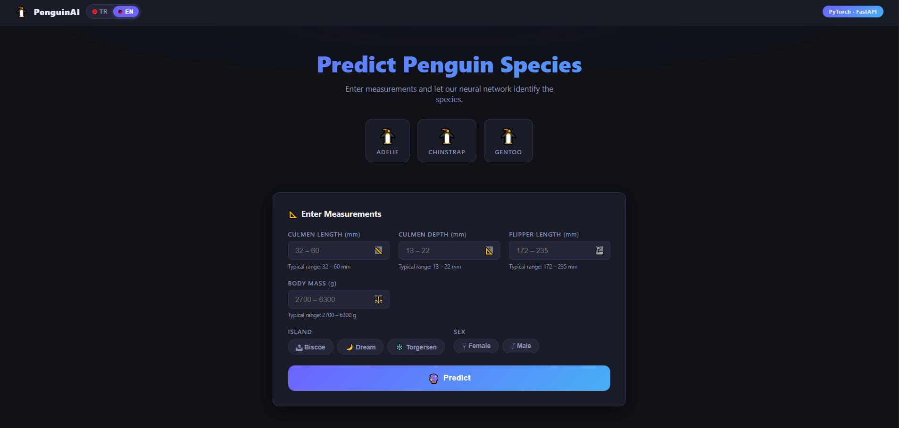

# Penguin Species Classifier

A web app that predicts penguin species (**Adelie**, **Chinstrap**, **Gentoo**) from body measurements, using a PyTorch neural network served with FastAPI.



## Features

- Multi-class classification with a feedforward neural network (MLP) built in PyTorch
- REST API with FastAPI (`/predict`, `/health`, interactive docs at `/docs`)
- Simple web interface (HTML, CSS, JavaScript) for entering measurements and viewing class probabilities

## Model

| Item | Detail |
|---|---|
| Task | Multi-class classification (3 species) |
| Architecture | MLP: 8 → 16 → 16 → 3, ReLU activations |
| Loss / Optimizer | CrossEntropyLoss / Adam |
| Test accuracy | [%100] |

### Input features (8)

- Culmen length (mm), culmen depth (mm), flipper length (mm), body mass (g), all standardized with `StandardScaler`
- Sex (Female = 0, Male = 1)
- Island, one-hot encoded: Biscoe, Dream, Torgersen

### Data preparation

- Replaced the invalid `"."` value in `sex` with NaN and dropped the rows with no measurements
- Imputed missing `sex` values with a RandomForest classifier trained on the known rows
- Label-encoded the target (`species`), one-hot encoded `island`
- Stratified train/test split, scaler fitted on the training set only

The full process, including exploratory data analysis, is in [`notebooks/model&EDA.ipynb`](notebooks/model&EDA.ipynb).

## Project structure

```
├── app/
│   ├── main.py              # FastAPI backend
│   ├── penguin_model.pth    # trained model weights
│   ├── scaler.pkl           # fitted StandardScaler
│   ├── label_encoder.pkl    # species label encoder
│   ├── columns.pkl          # feature column order
│   └── requirements.txt
├── static/                  # frontend (index.html, style.css, app.js)
└── notebooks/
    ├── model&EDA.ipynb      # EDA, preprocessing, training, evaluation
    └── penguins_size.csv    # dataset
```

## Run locally

```bash
git clone https://github.com/berkbnbr01/PenguinClassifierWebApp.git
cd PenguinClassifierWebApp
pip install -r app/requirements.txt
uvicorn app.main:app --reload
```

Open http://127.0.0.1:8000 in your browser.

## API

| Endpoint | Method | Description |
|---|---|---|
| `/` | GET | Web interface |
| `/predict` | POST | Returns predicted species and class probabilities |
| `/health` | GET | Service status, feature columns, class labels |
| `/docs` | GET | Interactive Swagger documentation |

Example request:

```json
{
  "island": "Dream",
  "culmen_length_mm": 45.0,
  "culmen_depth_mm": 17.5,
  "flipper_length_mm": 195,
  "body_mass_g": 3800,
  "sex": "MALE"
}
```

## Dataset

Palmer Penguins dataset (`penguins_size.csv`), available on [Kaggle](https://www.kaggle.com/datasets/parulpandey/palmer-archipelago-antarctica-penguin-data). Data collected by Dr. Kristen Gorman and the Palmer Station LTER.

## Tech stack

Python, PyTorch, scikit-learn, pandas, FastAPI, Uvicorn, HTML/CSS/JavaScript